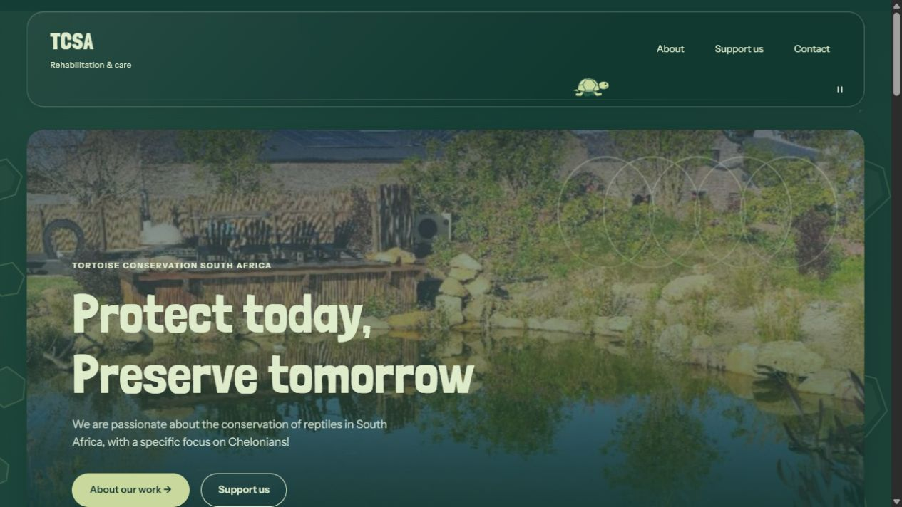
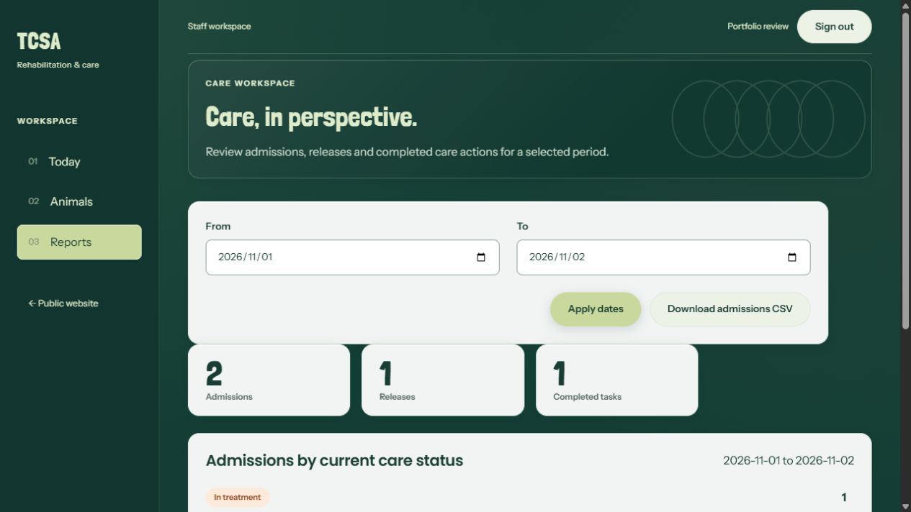
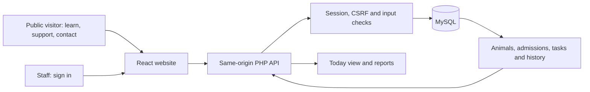

<p align="center"></p>

# TCSA Rehabilitation Platform

**Conservation website and staff care platform · React, PHP and MySQL**<br>
**Development and portfolio author:** Gedeon Kazadi · DV200, Semester 2

## Contents

- [About the project](#about-the-project)
- [Live websites](#live-websites)
- [Design reference](#design-reference)
- [Features](#features)
- [Development process](#development-process)
- [Run locally](#run-locally)
- [Deployment](#deployment)
- [Checks](#checks)
- [Challenges and solutions](#challenges-and-solutions)
- [Final outcome](#final-outcome)
- [Conclusion](#conclusion)
- [Credits and use terms](#credits-and-use-terms)

## About the project

A responsive website and staff care system for Tortoise Conservation South
Africa. The public website introduces TCSA's conservation work and ways to
support it. The staff area manages animal admissions, case notes, daily care
tasks and reports using a PHP API and MySQL database.

## Live websites

| Platform | Website |
| --- | --- |
| Azure | [TCSA on Azure](https://tcsa-rehabilitation-gkaz17-hebyf0hnd4cze8cb.southafricanorth-01.azurewebsites.net/) |
| AWS | [TCSA on AWS](https://tc-5b0e1ccaba9046b1b3cc6359db12c230.ecs.eu-north-1.on.aws/) |

Both versions include the public website and staff application. Staff access
requires an account. Each deployment has a separate database and credentials;
records do not automatically sync between them.

Azure is the primary site for search indexing and Google Analytics. The AWS
assessment copy uses noindex and does not load Google Analytics.

## Design reference

The public website implements the supplied UX200
[Group 11 TCSA design](https://www.figma.com/design/HIUzMJNOBMJiqloYjQW4oe/Group-11---TCSA?node-id=2907-20712),
with credit to the Group 11 UX200 design team. The staff area follows the
[TCSA Dashboard Redesign by Gedeon Kazadi](https://www.figma.com/design/rAYI0hpuL3R3WQlJ9gpVuc/).
The organisation's identity and conservation content belong to TCSA.

The public page keeps the original journey: introduction, About Us, reptile
gallery, Support Us, endorsements, sponsors and contact details. Shared teal
colours, typography and shell patterns connect the public and staff areas.
Layouts adapt to desktop, tablet and phone screens. Decorative motion has a
pause control and respects reduced-motion settings.

## Features

- Public conservation information, donation details and contact links.
- Staff sign-in, sign-out and required password replacement for temporary accounts.
- Animal intake, search, species/status filters and individual care profiles.
- Admissions, release and readmission while retaining earlier case history.
- Dated case notes linked to the staff member who added them.
- Scheduled care tasks, completion, reopening and cancellation.
- Today view with overdue, upcoming and completed care counts.
- Date-filtered reports and authenticated CSV downloads.

Care records are stored in MySQL and remain available after refresh or a later
sign-in. Animal identity is separate from each admission, with at most one
active admission per animal. Clinical history is retained rather than deleted.





Screenshots show local development checkpoints and demonstration care records. They illustrate the interface; they do not establish which later changes are deployed to each host.

## Technologies

| Area | Technologies |
| --- | --- |
| Frontend | React 19, React Router 7, Vite 8 and CSS |
| Backend | PHP, PDO prepared statements, server sessions and CSRF validation |
| Database | MySQL with versioned SQL migrations; XAMPP MariaDB for local development |
| Azure hosting | App Service on Linux with PHP 8.3 and Azure Database for MySQL |
| AWS hosting | Docker, Nginx, PHP-FPM, Amazon ECR, ECS Fargate Express Mode and RDS for MySQL |
| Checks | Oxlint, Node tests, PHP syntax checks and isolated database integration tests |
| SEO and analytics | Pre-rendered public HTML, page metadata, sitemap, robots.txt, GA4 and Google Search Console |

## Project structure

    client/       React application, styles, assets and frontend tests
    api/          PHP endpoints, authentication, care logic and CLI setup tools
    database/     SQL migrations, an earlier schema draft and isolated schema checks
    deployment/   Packaging scripts, runtime configuration and deployment guides
    docs/         Backend, sign-in and database documentation

React sends same-origin HTTP requests to PHP. PHP checks the session and input,
queries MySQL, and returns JSON for React to display. Database credentials stay
on the server and are never included in the frontend build.


## Development process

### Architecture and user flow



Public visitors follow the supplied conservation journey. Authenticated staff admit an animal, add case notes, schedule and complete care tasks, then review reports or record release/readmission. Animal identity and admission history are separate so a later admission does not overwrite earlier care.

See the [ER diagram](docs/DATABASE_ER_DIAGRAM.md), [rendered database diagram](docs/diagrams/tcsa-er-diagram.png) and [backend implementation](docs/BACKEND_IMPLEMENTATION.md) for the data relationships and endpoint decisions.

### Code decision: atomic care changes

From [`api/lib/care.php`](api/lib/care.php):

```php
function care_transaction(callable $action): mixed
{
    $pdo = database();
    $pdo->beginTransaction();
    try { $value = $action($pdo); $pdo->commit(); return $value; }
    catch (Throwable $error) {
        if ($pdo->inTransaction()) $pdo->rollBack();
        throw $error;
    }
}
```

Related care writes succeed together or roll back together. Record-version checks separately detect a stale edit and return a conflict instead of silently overwriting another staff member’s work. This supports the admission and task integrity rules documented in the backend guide.

## Run locally

Install Node.js 22.12 or later, npm, XAMPP and PowerShell 7. Local development
has been checked with Node.js 22.19 and XAMPP PHP 8.2.12.

Clone the project and install the frontend dependencies:

    git clone https://github.com/GKaz17/tcsa-rehabilitation-platform.git
    cd tcsa-rehabilitation-platform
    npm ci --prefix client

Start MySQL in the XAMPP Control Panel. For a new installation, run these
commands once from the project root:

    C:\xampp\php\php.exe api/bin/setup-local.php
    pwsh -NoProfile -File api/bin/create-staff.ps1

Enter the staff account details and password privately in the terminal. The
database initializer refuses to overwrite an existing configuration or
database. Existing installations apply pending migrations with:

    C:\xampp\php\php.exe api/bin/migrate.php

Start PHP from the project root:

    C:\xampp\php\php.exe -S 127.0.0.1:8080 -t api api/serve.php

In a second terminal, start the React development server:

    cd client
    npm run dev

Open [localhost:5173](http://localhost:5173/). Vite forwards /api requests to
PHP on port 8080. Staff sign-in is at /staff/login; the public footer logo's
tail also links there. See [staff setup](docs/STAFF_SIGNIN.md) for details.

Serve PHP through the supplied router, rather than exposing the project root
through Apache. Configuration, internal libraries and setup scripts must remain
private. Only public settings belong in VITE_ environment variables.

## Deployment

| Azure | AWS |
| --- | --- |
| Build the React client for the Azure HTTPS address with public indexing and GA4 enabled. | Build a separate client copy with indexing and GA4 disabled. |
| Package the built frontend, PHP endpoints and Nginx/startup configuration. Upload the release ZIP with Azure CLI. | Package the frontend and PHP API in a Docker image, verify it, push to private ECR and run it with ECS Fargate Express Mode behind an HTTPS load balancer. |
| Use App Service application settings for the restricted MySQL account and verified TLS connection. | Use Secrets Manager for runtime credentials and verified TLS to private, encrypted RDS MySQL. Database ingress is restricted to the web task's security group. |

Both deployments use a public document root and an explicit API endpoint
allowlist. Migrations and initial account creation run separately from ordinary
web requests. Temporary setup access is removed afterwards.

Detailed instructions: [Azure release](deployment/AZURE_RELEASE.md),
[Azure database setup](deployment/AZURE_DATABASE_STEPS.md),
[AWS deployment](deployment/aws/README.md) and
[analytics setup](deployment/ANALYTICS.md). Workflow templates are examples and
do not enable automatic deployment by themselves.

## Checks

From client/:

    npm run lint
    npm test
    npm run build
    npm run test:seo

Oxlint is the project's linter. npm run preview serves the compiled frontend
only; it does not proxy the PHP API.

From the project root, the backend integration suite uses disposable test
databases rather than application records:

    node --test api/tests/auth.integration.mjs

The [backend documentation](docs/BACKEND_IMPLEMENTATION.md) covers the API and
integrity rules. The [ER diagram](docs/DATABASE_ER_DIAGRAM.md) describes the
nine tables, 60 columns and ten foreign keys in migrations 001-003.

## Challenges and solutions

| Challenge | Solution |
| --- | --- |
| Azure sign-in failed despite valid application settings. | PHP workers and session files had different ownership. The startup configuration aligns the worker identity with the persistent volume and validates PHP-FPM and Nginx. |
| AWS provisioning failed with IAM errors. | Checked the infrastructure policy and service-linked roles, allowed permissions to propagate, then retried the existing service. |
| Windows checksum files failed on Linux. | Used LF line endings and verified release files before running setup. |
| CloudShell ran out of temporary storage. | Checked disk use, preserved setup state, recovered capacity and resumed without creating duplicate database resources. |
| Releases, readmissions and simultaneous edits could leave inconsistent care records. | Separated animals from admissions and used foreign keys, transactions, a unique active-admission rule and edit-version checks. |

## Current limitations and next steps

- Replace photographs and logos cropped from the supplied design preview with original image exports when available.
- Link carers to staff accounts; the current admission form records a carer's name as text.
- Add self-service password recovery and image uploads. These are not implemented yet.
- Deploy and verify the latest completed-task cancellation guard on both hosts. It is in the source, but the last verified hosted checkpoint predates that correction.
- Continue reviewing real traffic and search results. GA4 setup events and Search Console verification confirm measurement setup, not long-term SEO performance.

Keep environment settings, passwords, database exports, sessions, generated
builds and release archives out of Git. The repository contains source code,
tests, migrations, dependency lockfiles and blank example configuration.
## Final outcome

The [Azure application](https://tcsa-rehabilitation-gkaz17-hebyf0hnd4cze8cb.southafricanorth-01.azurewebsites.net/) and [AWS application](https://tc-5b0e1ccaba9046b1b3cc6359db12c230.ecs.eu-north-1.on.aws/) provide the public website and authenticated staff workspace. Their databases are independent. Local changes must be packaged and verified on each host before they can be described as deployed.

**Demo video:** the required 5–8 minute portfolio recording has not yet been linked.

## Conclusion

The main outcome is a joined public and staff system with persistent care records and two cloud deployments. Separating animal identity from admissions made releases and readmissions easier to model without losing clinical history. The deployment work also exposed practical issues with permissions, sessions, environment settings and cross-platform packaging, described above.

My contribution covers application development, staff dashboard redesign, integration, database implementation and deployment. The public visual direction comes from the credited Group 11 UX200 team. Next steps are the improvements listed above, followed by further staff workflow testing and verified releases.

## Credits and use terms

- **Development and contact:** [Gedeon Kazadi](https://github.com/GKaz17) · [21100471@virtualwindow.co.za](mailto:21100471@virtualwindow.co.za)
- **Public website design:** Group 11 UX200 design team, [supplied TCSA design](https://www.figma.com/design/HIUzMJNOBMJiqloYjQW4oe/Group-11---TCSA?node-id=2907-20712). This design is not presented as my original UX work.
- **Staff interface design:** [TCSA Dashboard Redesign — Gedeon Kazadi](https://www.figma.com/design/rAYI0hpuL3R3WQlJ9gpVuc/).
- **Identity and content:** Tortoise Conservation South Africa. Some photographs and logos are cropped from the supplied design preview; original source exports and full image attribution remain outstanding.
- **Libraries and runtime:** [React](https://react.dev/), [React Router](https://reactrouter.com/), [Vite](https://vite.dev/), [PHP](https://www.php.net/), MySQL/MariaDB and Oxlint. Deployment uses Azure, AWS, Docker, Nginx and PHP-FPM; package and platform rights remain with their owners.
- **Fonts:** Poppins, Londrina Solid and Instrument Sans; the bundled Open Font Licence files are in `client/public/fonts`.
- **AI assistance:** OpenAI ChatGPT/Codex assisted with implementation, debugging, checks and documentation. Design ownership and the limits of available assets are credited separately above.
- **Use terms:** Academic and portfolio implementation. No repository-wide open-source licence has been granted. TCSA identity/content, supplied designs, photographs, fonts and third-party software retain their respective rights and licences.
