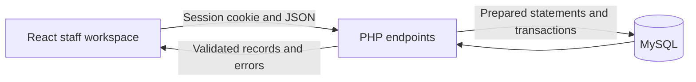

# Care backend implementation

Initial local implementation: 21 October 2026. Hosted checkpoints now include
Azure and the separate AWS React/PHP/MySQL deployment. AWS staff sign-in,
mandatory password replacement and animal/note persistence were confirmed by
the user, including a refresh after temporary setup access was removed.

Local integrity review: 27 October 2026. The completed-task cancellation guard
and its new regression checks are local changes awaiting hosted deployment;
they are not claimed as already running on either hosted site.

## Data flow

The dashboard no longer starts from in-memory animals and tasks. It requests
`workspace.php` after authentication and reloads after successful changes.
The public landing page, its content journey and its analytics setup are separate.

## Supported care journeys

- Create and read an animal and its admission, edit care details and care status.
- Release an animal, cancel its outstanding tasks and retain its completed care.
- Readmit the same animal without replacing its earlier admission or case history.
- Append dated case notes with staff authorship, without rewriting old notes.
- Schedule care, complete a task, undo completion and cancel an outstanding task.
- View real date-filtered admission, release and completed-task counts.
- Download authenticated admissions CSV with spreadsheet formula protection.
- Sign in, sign out and replace a temporary password before opening records.

No hard-delete endpoint is provided for clinical history. Photo is a task
category; this checkpoint does not implement image uploads or a prescribing system.

## Schema and migrations

`001_staff_signin.sql` remains the first migration. `002_animal_management.sql`
promotes the reviewed animal draft. `003_care_workflows.sql` adds task/audit
tables, version counters and the mandatory password-change state. See
[the database ER diagram](DATABASE_ER_DIAGRAM.md) for all tables, fields and
relationships.

| Table | Responsibility |
| --- | --- |
| staff_users | Staff identity, Argon2id password hash, active state and password version |
| auth_login_limits | Account/IP sign-in failure limits |
| schema_migrations | Applied migration versions |
| care_statuses | Four controlled care-status lookup values |
| animals | Stable record identity, name and species |
| admissions | Each period of care, status, location, carer and release date |
| case_history_entries | Dated notes associated with an admission and author |
| care_tasks | UTC schedule, completion, cancellation and staff attribution |
| care_audit_events | Acting staff, admission, task/action and time |

An animal can have many historical admissions, with a generated unique key
allowing at most one active admission. Case entries belong to admissions. Versions
and admission IDs prevent both stale saves and an old form changing a later
readmission whose version counter happens to match.

The audit table records actions and attribution. It is not a full before/after
snapshot of every edited field. Readmission and the case timeline preserve
previous admissions and notes.

The chk_task_completion constraint requires completion time and completing staff
to be both NULL or both populated. Completing and reopening update the pair
together. The API permits cancellation only while a task is outstanding: a
completed task must be reopened first; a cancelled task cannot be completed.
This exclusivity is an application rule, not an additional SQL CHECK in
migrations 001-003.

Task changes select the task by both task ID and the locked admission ID before
writing its audit event in the same transaction. Cross-admission requests are
rejected without changing the task or adding an audit event. The independent
audit foreign keys do not enforce this match for direct SQL writes.

The carer_name column is descriptive text. It does not assign a case to a
registered staff account. Staff account assignment would require a separate
schema change.

Run `php api/bin/migrate.php` against the local configuration. Only this CLI uses
the administrative migration account; the runtime keeps SELECT/INSERT/UPDATE/DELETE.
DDL may commit implicitly. Do not assume a partially failed migration rolled
back; inspect its schema and take a backup before repairing production DDL.
The runner skips recorded versions and never drops existing tables or records.

## HTTP endpoints

| Method | Endpoint | Behavior |
| --- | --- | --- |
| GET | /api/health.php | Code/runtime marker, not a database availability check |
| GET | /api/auth/session.php | Anonymous or signed-in session and CSRF form token |
| POST | /api/auth/login.php | Rate-limited sign-in |
| POST | /api/auth/logout.php | Revoke current session |
| POST | /api/auth/password.php | Validate current password, require a new 12-character password, rotate session |
| GET | /api/auth/me.php | Current staff identity, blocked until temporary password is changed |
| GET | /api/workspace.php | Authenticated animal/history/task records and South Africa care clock |
| POST | /api/animals.php | create, update or readmit action |
| POST | /api/history.php | Append a case note |
| POST | /api/tasks.php | create, complete/reopen or cancel action |
| GET | /api/reports.php | Date-filtered counts, or format=csv for an export |

Every mutation requires a session, valid origin and CSRF token. Server validation
checks types, Unicode text length, whitespace-only values, dates, statuses and
task categories. Writes that span tables use transactions and row locks.
Conflicts return 409, invalid fields 422, anonymous access 401, incomplete
password setup 428, and unavailable configuration/database 503. Private JSON
responses are no-store/noindex and raw database messages are not returned.

## Temporary passwords

The CLI accepts a temporary password through stdin with `--temporary` and marks
the account as requiring a change. `--reset` is an explicit administrative reset
for an existing account, never an HTTP endpoint. Normal account creation and
password replacement require at least 12 characters. Temporary setup accepts at
least eight characters, but records remain inaccessible until replacement.

The browser routes a temporary account to `/staff/password`. PHP independently
rejects care endpoints until the flag is cleared. Password replacement rotates
the session/CSRF token and increments a password version, invalidating every
older session. Existing password arguments, hardcoded passwords and bypasses
are not part of the application. Passwords are never included in release ZIPs.

## Clocks and reporting

The server owns the care clock in Africa/Johannesburg. Tasks are stored in UTC
and returned as South Africa date/time values. Today includes overdue unfinished
work and tasks completed on the selected care day; future tasks do not inflate
today's counts. Reports count admissions in the selected intake date range,
releases whose release date is in range, and task completions during that local
date range. Status bars describe those admissions' current statuses.

## Verification and evidence

`node --test api/tests/auth.integration.mjs` contains 20 groups against a freshly
generated isolated database/account and PHP listener, then removes only those
generated test resources. It tests successful persistence, sessions, password
change, validation, conflicts, notes, timezone conversion, task actions, reports,
CSV protection, release and readmission. Client/unit tests and built-SEO checks
are separate checks. Oxlint is preserved without configuration changes.

Browser acceptance evidence uses a different database and cookie/session path
from the user's local account. Fictional Willow data was entered through the
real forms. The checks include refresh persistence, notes, task completion,
report export, edits, release/readmission, wrong password, 422 field validation,
409 concurrent editing, anonymous rejection and controlled configuration failure
followed by recovery. Screenshots and raw logs are delivered outside the repo.
The attempted mobile override reported a desktop viewport, so its screenshot
is labelled desktop and is not claimed as new mobile verification.

## Azure connection procedure and original verification boundary

The following procedure records the original 21 October preparation. Its
pending-verification statements describe that point in time; see the current
deployment checkpoint in README.md for the accepted hosted state.

The runtime now supports verified TLS for hosted MySQL using DB_SSL_CA and
refuses production connections without an encrypted session. The startup Nginx
whitelist and release package include the new endpoints, while setup tools,
SQL, sessions and local configuration remain outside the web artifact.

Deploy the updated package before creating a temporary public staff account.
Then use an existing reviewed Azure MySQL Flexible Server. The private Cloud
Shell helper `deployment/azure-database-setup.py` applies schema, creates the
restricted runtime account, hashes the first temporary staff password and saves
app settings without printing them. It creates no billable server/firewall rule.
Its Python syntax was checked locally; Azure execution/TLS and end-to-end hosted
sign-in still require verification. Local Python dependency installation was
blocked by the machine's Avast TLS integration; endpoint protection was unchanged.

Review the actual server price/free allowance before provisioning. Configure
network rules for the application's outbound addresses and the setup connection,
retain require_secure_transport, and verify Secure session cookies on the live
HTTPS origin. Analytics/GA4 and Search Console are still separate pending work.
The second hosting platform should follow the first working hosted backend.
