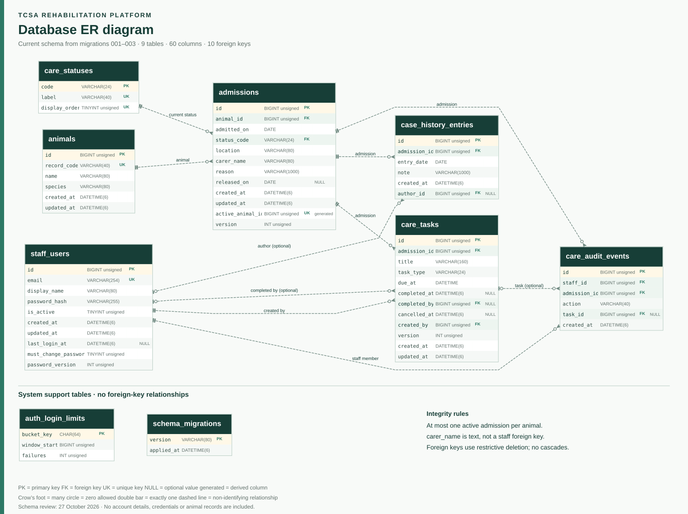
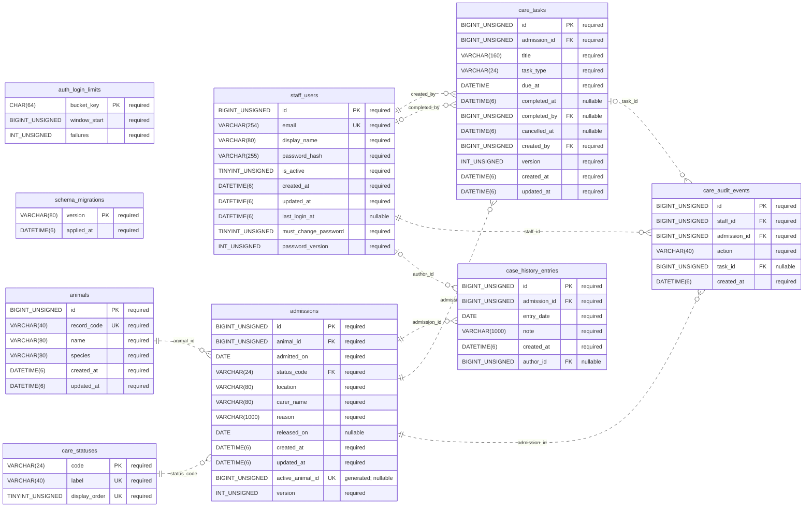

# TCSA database ER diagram

Schema checkpoint: 27 October 2026.

[PNG for presentations](diagrams/tcsa-er-diagram.png) |
[Editable Mermaid source](diagrams/tcsa-er-diagram.mmd)

## Schema basis

This diagram follows migrations 001_staff_signin.sql, 002_animal_management.sql
and 003_care_workflows.sql, including their ALTER TABLE additions: **9 tables,
60 columns and 10 foreign keys**. It describes the versioned schema, not a new
inspection of either hosted database.

## Relationships

| Parent key | Child foreign key | Parent rows per child | Child rows per parent |
| --- | --- | --- | --- |
| `animals.id` | `admissions.animal_id` | 1 | 0..many |
| `care_statuses.code` | `admissions.status_code` | 1 | 0..many |
| `admissions.id` | `case_history_entries.admission_id` | 1 | 0..many |
| `admissions.id` | `care_tasks.admission_id` | 1 | 0..many |
| `staff_users.id` | `care_tasks.created_by` | 1 | 0..many |
| `staff_users.id` | `care_tasks.completed_by` | 0..1 | 0..many |
| `staff_users.id` | `care_audit_events.staff_id` | 1 | 0..many |
| `admissions.id` | `care_audit_events.admission_id` | 1 | 0..many |
| `care_tasks.id` | `care_audit_events.task_id` | 0..1 | 0..many |
| `staff_users.id` | `case_history_entries.author_id` | 0..1 | 0..many |

## Integrity rules and current limits

- An animal keeps one identity across separate admissions. The generated unique
  admissions.active_animal_id permits **at most one active admission per animal**;
  after release there can be none. Intake creates the first admission.
- Case history and scheduled care belong to a particular admission. Staff links
  record note authors, task creators, completing staff and audit actors.
- The nullable foreign keys are case_history_entries.author_id,
  care_tasks.completed_by and care_audit_events.task_id.
- chk_task_completion requires completed_at and completed_by to be both NULL
  or both populated. Completion sets both; reopening clears both.
- The PHP API rejects cancellation of a completed task until it is reopened,
  and rejects completion of a cancelled task. This exclusivity is an application
  rule, not an additional SQL CHECK in migrations 001-003.
- Task changes look up both task ID and the locked admission ID, then add the
  audit event in the same transaction. Independent foreign keys alone cannot
  prevent a mismatched task/admission pair written through direct SQL.
- carer_name is descriptive text, not assignment to a registered staff account.
  Staff assignment would require a separate schema change.
- Foreign keys use restrictive deletion. No cascade deletion is declared.
- auth_login_limits and schema_migrations have no foreign-key relationships.

## Verification

Twenty backend integration groups passed locally on 27 October 2026 using a
fresh isolated XAMPP MariaDB database and PHP listener. The checks include zero
active admissions after release, rejection of a second active admission, paired
completion fields, completed/cancelled task transitions and rejected requests
that combine a task from an earlier admission with a later admission.

This local run is not a new verification against either cloud MySQL engine.
The completed-task cancellation correction is awaiting hosted deployment.

## Legend

PK means primary key, FK means foreign key, UK means unique key and NULL marks
an optional value. A crow's foot means many, a circle permits zero, and a double
bar means exactly one. Dashed relationships are non-identifying: the child
foreign key is not part of its primary key.

## Editable diagram

