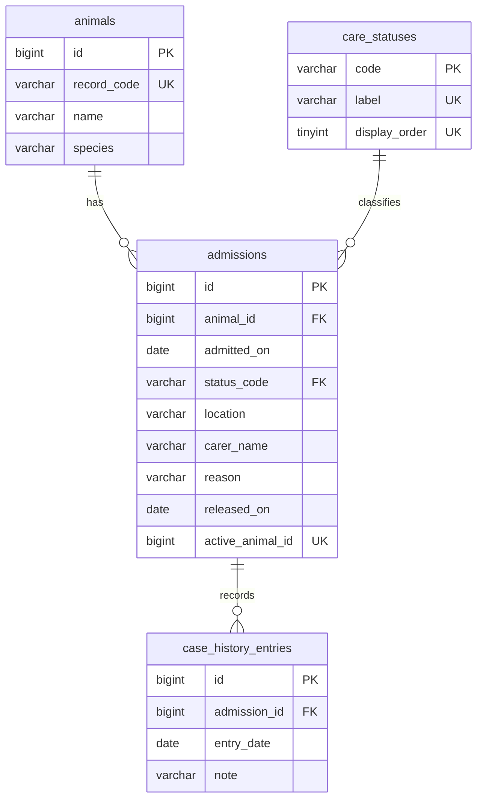

# Database stage one - 7 October 2026

This checkpoint defines the first animal-management data model for local review.
It starts from `28d9237`. The canonical PROJECT_NODE, CURRENT_STATUS and
CODEX_BUILD_SPEC were reread, along with the actual intake, animal list, profile
and fixture data. This schema proposal changes no frontend or PHP endpoint behavior;
the separate authentication portion is documented in `STAFF_SIGNIN.md`.

The SQL lives in `database/drafts/001_animal_management.sql`. It is a proposal,
not an applied migration. It contains no database creation, credentials, user
accounts, destructive commands or real animal records. Only the four existing
care-status lookup values are inserted.

## Tables and relationships



An animal keeps one identity across admissions. Each admission owns its care
status, location, assigned-carer text, admission reason and notes. This lets a
returning animal receive a new case while its previous history remains intact.
The existing UI displays the latest admission, ordered by admission date and
internal ID. A future readmission screen is outside this first slice.

Internal IDs are unsigned numbers. Public routes continue to use a unique
`TCSA-...` record code. PHP will generate a full random identifier rather than the
current eight-character client fixture identifier. Existing fixture-style codes
fit the schema, but fixtures will not be silently imported as real cases.

## Existing field mapping

| Current frontend field | Database field | Rule for the first PHP slice |
| --- | --- | --- |
| `id` | `animals.record_code` | Generated by PHP, immutable, unique, maximum 40 ASCII characters |
| `name` | `animals.name` | Required, trim, maximum 80 characters |
| `species` | `animals.species` | Required, trim, maximum 80 characters; preserve current free-text input |
| `admitted` | `admissions.admitted_on` | Required real calendar date, not after the live South African care date |
| `status` | `care_statuses.label` via `admissions.status_code` | Exact allowlist of the current four labels |
| `location` | `admissions.location` | Required, trim, maximum 80 characters |
| `carer` | `admissions.carer_name` | Required, trim, maximum 80 characters; a name, not proof of an authenticated account |
| `reason` | `admissions.reason` | Required, trim, maximum 1,000 characters |
| `history[].date` | `case_history_entries.entry_date` | Valid date, no earlier than admission and no later than the current care date |
| `history[].note` | `case_history_entries.note` | Required, trim, maximum 1,000 characters |
| `nextCare` | Future task query | Derived when task persistence is implemented; not duplicated in animal data |

The stable status codes are `in_treatment`, `rehabilitation`,
`ready_for_release` and `released`. PHP maps them to the current UI labels.
Animal/species names are not unique: two animals may share a name or species.
Species and carers remain free text to match the current reviewed form. Controlled
species, staff accounts and carer assignment need separate reviewed changes.

## Integrity and dates

Foreign keys prevent orphan admissions and notes. Their default restrictive
actions prevent deleting an animal with linked cases or a case with notes.
There is no cascade deletion and no delete endpoint in the proposed first slice.

A generated column and unique index enforce at most one non-released admission
per animal, including concurrent writes. Changing an admission to Released frees
that slot. `released_on` is optional because the existing form has no release-date
field; a missing date stays unknown. If provided, it must belong to a released
case and cannot precede admission. Release workflow, further outcome categories
and readmission UI still need review; do not infer dates from unrelated notes.

All tables use InnoDB and the shared `utf8mb4_unicode_ci` collation. Record and
status codes use case-sensitive ASCII. Timestamps are recorded in UTC; date-only
care fields follow Africa/Johannesburg. PHP must replace the fixed frontend
fixture clock with the live local date when this slice is connected.

Database checks reject ordinary blank text and impossible release-date order.
PHP must additionally reject whitespace-only Unicode input, enforce character
limits, reject invalid/future dates and compare a note date with its admission.
It must use parameterised SQL, strict SQL mode and a UTC connection. Do not rely
on HTML validation, silently truncate input or disable integrity constraints.

## Next PHP contract

These endpoints are planned, not implemented:

| Endpoint | Expected behavior |
| --- | --- |
| `GET /api/animals.php` | Return one row per animal using its latest admission, with the current field names |
| `GET /api/animal.php?id=TCSA-...` | Return the latest admission and its own history; unknown record returns 404 |
| `POST /api/animals.php` | Validate the seven intake fields, create identity, admission and initial reason note in one transaction; return 201 only after commit |

The POST body uses the current `name`, `species`, `admitted`, `status`, `location`,
`carer` and `reason` fields. Server-generated IDs, timestamps and initial history
must not be accepted from the client. Initial history uses the validated admission
date and reason, matching the current form. Roll back all three inserts on any
failure. A duplicate generated record code must be handled without partial data.

Responses keep the existing `success`, `data`, `message`, `errors` envelope.
Validation failures return 422 with field errors; unavailable database returns
503 with a safe message; record conflicts return 409. Do not expose SQL, connection
settings or exception traces. Unexpected errors return 500. React will gain real
loading, empty, error and success states when this contract is implemented.

Profile notes are ordered by `entry_date DESC, id DESC` so notes on the same day
stay deterministic. Prior admissions remain stored; the current profile does not
silently mix their notes into the latest case.

Staff login, authorization, note authorship, edit/status-change history, photos,
medication records and task scheduling are separate checkpoints. No authenticated
author is invented here. The existing dashboard still uses its fictional in-memory
data. Real staff or animal data must wait for authenticated, authorized endpoints.

## Compatibility and verification

The installed XAMPP server identifies itself as MariaDB 10.4.32, not Oracle
MySQL. The draft targets MySQL 8.0.16+ and the local MariaDB engine, using common
InnoDB, foreign-key, generated-column and CHECK syntax. MySQL 8.0.16 is the minimum
because earlier versions do not enforce CHECK constraints. MySQL execution still
needs verification before choosing it as the deployment engine.

Run the isolated local check in PowerShell 7 from the repository root:

```powershell
pwsh -NoProfile -File database/tests/verify-schema.ps1
```

The checker runs XAMPP's existing binary with `--no-defaults --bootstrap
--skip-networking` in a newly generated temporary directory. It never connects
to the installed XAMPP data directory, reads a credentials file or starts a
service/listener. Its fictional data is confined to that temporary directory,
which is removed after the check. Never import `database/tests/schema-valid.sql`
into an application database.

Checks cover schema creation, Unicode and apostrophes, intake transaction rollback,
readmission, deterministic case history, unknown release date, duplicate codes,
text limits, blank fields, orphan records, invalid dates, a second active case
and restricted deletion. All 15 checker groups passed on MariaDB 10.4.32 on
7 October 2026; the temporary directory was removed. The PowerShell script parses
without errors. Oxlint, the three existing task tests and PHP health syntax also
pass. The unchanged React frontend builds successfully into a fresh temporary
output folder. The normal `dist/` cleanup was blocked by a local file-permission
restriction, so the build check used `--outDir` with an isolated output location.
MySQL itself has not been executed for this checkpoint.

The draft deliberately fails if its tables already exist. Applying it twice is
not an upgrade strategy. DDL can commit implicitly: select a new empty development
database only after review. Later stages must add an explicit migration/version
process before applying changes to populated databases.

## Review checkpoint

Confirm the seven current intake fields and the four current statuses are enough
for the first persistence flow. The proposed repeat-admission model, optional
release date and free-text carer/species preserve the current UI while allowing
later workflows. Final author attribution and staff roles remain undecided.

Once this structure is reviewed, the next checkpoint is the local PHP connection
and create/list/profile flow using fictional test records. Database credentials,
if then authorised, belong only in ignored local configuration. This stage has
not been committed, pushed, deployed or applied to an application database.

References: [canonical build specification](https://github.com/GKaz17/jarvis-os/blob/main/01-PROJECTS/tcsa-rehabilitation-platform/CODEX_BUILD_SPEC.md),
[MySQL CHECK constraints](https://dev.mysql.com/doc/refman/8.0/en/create-table-check-constraints.html),
[MySQL generated columns](https://dev.mysql.com/doc/refman/8.0/en/create-table-generated-columns.html),
[MariaDB bootstrap options](https://mariadb.com/docs/server/server-management/starting-and-stopping-mariadb/mariadbd-options).
